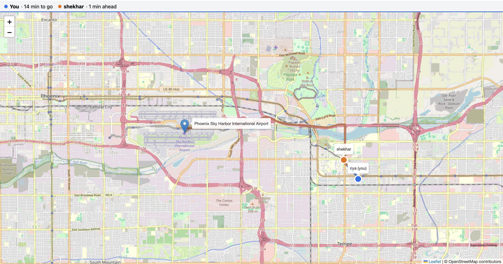

# Group Drive

When you drive somewhere in more than one car, it's easy to lose each other and spend the trip texting "where are you??" Group Drive links the cars with a single share link, so everyone sees every car live on one map.

**Status:** v1 works. Two cars sync live on a map.

**Demo:** https://group-drive.vercel.app (open it on two phones to try it with two cars)

## Screenshot

<!-- To add a screenshot: save an image as docs/screenshot.png, then replace the line below with:
 -->
_Screenshot coming soon._

## Tech stack

- **[Leaflet](https://leafletjs.com/)**: the map
- **[OpenStreetMap](https://www.openstreetmap.org/)**: the map images (free, no API key)
- **[Firebase Realtime Database](https://firebase.google.com/docs/database)**: syncs each car's location live
- Plain HTML, CSS, and JavaScript. No build step.

## Run it locally

1. Clone the repo:
   ```
   git clone https://github.com/riyaubhe/group-drive.git
   cd group-drive
   ```
2. Start a local server. The app won't work if you just double-click `index.html`.
   ```
   python3 -m http.server 8000
   ```
3. Open http://localhost:8000, enter a car name, click **Create a trip**, and allow location access.
4. Copy the share link and open it in a private/incognito window to join as a second car.

To use your own Firebase project, put its settings in `firebase-config.js`.

## Learn more

The full product spec is in [docs/PRD.md](docs/PRD.md).
