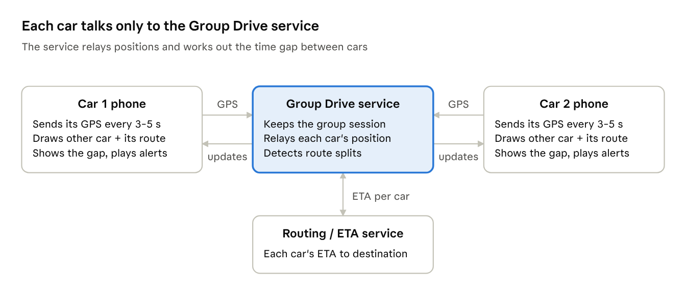

# Group Drive — PRD

Group Drive is an idea for a Google Maps feature for when you're driving somewhere in more than one car. You link the cars together, and then everyone can see the other car and the route it's taking right on the navigation screen. There's also a little bar that says something like "Car 2 · 4 min behind," and Maps tells you if the other car goes a different way. When everyone gets there, it turns itself off.

I think this should be part of Google Maps instead of its own app. Pretty much everyone already uses Maps, and nobody is going to download a whole new app just for one road trip.

## The problem

On a trip with friends, we rented two cars. Almost every place we drove to had more than one way to get there, and Google Maps would send each car a different "fastest" route. So we'd split up, lose track of each other, and spend the drive texting "where are you??" and sending screenshots.

You might think Google Maps location sharing already fixes this. It kind of does, but not really:

- It's in a separate menu, not on the screen you're looking at while driving.
- You only see a dot. You can't tell which road they're on.
- It doesn't tell you how far ahead or behind they are.
- You have to turn it on yourself and remember to turn it off later.

So the real problem is this: when you're driving somewhere in more than one car, there's no easy way to see where the other cars are, what route they're on, and how far apart you are, without leaving navigation.

## Who it's for

Mostly the person in the passenger seat who's handling the phone. The driver matters too, but they should only have to glance at the screen or hear an alert.

| Who | What's going on | What they need |
| --- | --- | --- |
| Friends on a road trip | 2 or 3 rental cars, new roads every day | See the other car without texting |
| Families | Parents and grandparents driving to the same vacation spot | Stay on the same route and know who's ahead |
| People going to an event | A few cars coming from different places to a wedding, game, or concert | Know when everyone's getting there |

Who it's not for: car clubs and big rally groups with 20+ cars. There are already apps made just for them.

## What's already out there

Google actually patented something like this, but it hasn't come out. The other apps that do this are mostly for car enthusiasts, not regular people on a trip.

| What | What it does | Why it doesn't fit regular group trips |
| --- | --- | --- |
| Google Maps location sharing | Shows your friend's dot on the map | Separate menu, no route, no time gap, you turn it on and off yourself |
| [Google's co-navigation patent](https://www.phonearena.com/news/a-future-google-maps-feature-will-help-you-co-navigate-with-friends-and-family_id160008) | Invites, everyone's location, meeting spots, alerts if someone takes a detour | It's only a patent, so it might never come out |
| [Koast](https://alternativeto.net/software/koast/about/) | Shared map, push-to-talk, same route for everyone | Separate app, made for car and motorcycle groups |
| [Convoy Tracker](https://apps.apple.com/app/id6753726393) | Make a convoy, invite people, drive the same route | Separate app, made for car meets and rallies |
| [Strada1](https://apps.apple.com/app/strada1/id6752026119) | Live convoy map, find convoys near you | Separate app, you pay for passes, made for car fans |
| [AutoLNK DriveShare](https://www.autolnkusa.com/community/best-app-for-group-drives-and-car-cruises) | Live location of every car, voice and group chat | Made for car cruises and rallies |

So Group Drive would basically be a smaller version of Google's patent idea, made for normal people, and built right into the Maps screen they already use.

## Goals

What I want Group Drive to do:

- Let every car see the other cars and their routes without leaving navigation.
- Get rid of the "where are you??" texts and calls.
- Take one invite to set up, and turn off by itself.
- Never make the driver tap anything while driving.

What I'm not doing in the first version:

- Making every car take the same route. People can still pick, they'll just see when they split up.
- Voice chat between cars.
- Figuring out on its own that you're on a group trip (like from your calendar or texts).
- Big groups of more than 5 cars.
- Meeting spots and "slow down" suggestions. Those are in the later ideas.

## User stories

Must have:

- As the person planning the trip, I want to start a Group Drive and send one link, so the other car can join fast.
- As a passenger in the other car, I want to join from the link without making an account, so we don't waste time at the start.
- As a passenger, I want to see the other car and its route on my screen, so I know if they took a different highway.
- As a passenger, I want to see "Car 2 · 4 min behind," so I know if we should slow down or wait.
- As a driver, I want to hear an alert when the other car goes a different way, so I don't have to look at my phone.
- As anyone in the group, I want sharing to stop when we get there, so my location isn't shared forever.

Nice to have:

- As a passenger, I want to tap "Use their route," so both cars end up on the same road.
- As anyone in the group, I want to leave whenever I want, so I'm in control of my location.

## First version (MVP)

The first version is basically location sharing, but inside navigation and just for one trip.

How it works:

1. You pick a destination, hit "Start Group Drive," and send the link.
2. The other car opens the link and joins. Both cars get the same destination and, by default, the same route.
3. While driving, you see the other car and its route in a different color.
4. A bar at the top says how far apart you are, like "Car 2 · 4 min behind."
5. If one car goes a different way, the other car gets a voice alert, and the passenger can tap "Use their route."
6. When everyone arrives (or after a time limit), sharing stops.

| Thing | How it should work |
| --- | --- |
| How many cars | 2 to 5 |
| Location updates | Every 3 to 5 seconds while moving |
| "Minutes behind" | Based on when each car will arrive, not just distance |
| Different-route alert | Only if a car is off the other's route for about 30 seconds |
| Driver safety | No tapping needed while driving, alerts are spoken |
| Privacy | You turn it on per trip, and it stops when you arrive or after 12 hours max |

Not in the first version: voice chat, meeting spots, auto-detecting trips, CarPlay and Android Auto screens, and walking or transit.

## How I'd measure success

The main thing I'd track is how often all the cars get there within 5 minutes of each other, since that's the whole point. I don't have real numbers yet, so I'd get a starting point from interviews and a test run first.

| What I'd track | Why |
| --- | --- |
| How often all cars arrive within 5 minutes | Shows if the group actually stays together |
| How many invites get accepted | Shows if it's easy to set up |
| How many Group Drives get started each week | Shows if people are finding it |
| How often people tap "Use their route" after an alert | Shows if the alerts are useful or just annoying |
| How many people use it again within 3 months | Shows if it actually helped |
| How much the driver taps while moving | Should be close to zero |
| Battery use compared to normal navigation | It shouldn't kill your phone |
| Trips that keep sharing after arriving | Should be zero |

## What could go wrong

The biggest worry is distracting the driver, so most of the design is about keeping their eyes on the road.

| Problem | What could happen | What I'd do about it |
| --- | --- | --- |
| Distracted driver | The driver keeps checking the screen for the other car | Spoken alerts, nothing for the driver to tap, buttons meant for the passenger |
| Privacy | Location keeps getting shared after the trip, or with the wrong person | Turn it on per trip, auto-stop when you arrive, 12-hour limit, leave anytime |
| Battery | Sending location nonstop drains phones on long drives | Send updates less often when stopped or on long highway stretches |
| Bad signal | No signal in the middle of nowhere, so the other car looks frozen | Show "last seen 2 min ago" and their last known route |
| Too many alerts | Small detours set off alerts all the time | Only alert after about 30 seconds off route, and let people mute alerts |
| People don't use it | Nobody remembers it's there | Suggest Group Drive when you share a destination with someone |

## How it would work (technical side)

The phones don't talk to each other directly. Each car sends its location to one Group Drive server, and the server passes it on to the other cars and figures out how far apart they are.

"Minutes behind" comes from comparing when each car will arrive, so it's about time, not distance.

How the syncing works:

- Each phone keeps a live connection to the server (a WebSocket), so updates show up in about a second.
- Each update is tiny: which car, where it is, how fast it's going, which direction, and the time.
- The server only keeps each car's latest location, and it deletes everything when the trip ends.
- If a phone loses signal, the others see "last seen X min ago," and it catches up once it's back.
- A car counts as "on a different route" if it's more than about 100 meters off the other car's route for about 30 seconds.

What I'm using to build the prototype:

| Part | Tool | Why |
| --- | --- | --- |
| The app | HTML and JavaScript in the browser | No app store, anyone can open a link on their phone |
| The map | Leaflet and OpenStreetMap | Free and doesn't need an API key |
| Your location | The browser's built-in location feature | Works on every phone |
| Live syncing | Firebase (or Supabase) | Free, and live updates are built in |
| Routes and arrival times | OSRM or Google's Routes API | Gives the route line and travel time for each car |
| Hosting | Vercel | I already use it for my portfolio |

## Launch plan and later ideas

I'd roll it out slowly and only move to the next step if things like battery and privacy look okay.

1. Test it with employees on real trips and fix bugs.
   - Move on when: nothing keeps sharing after arrival, and battery use is close to normal navigation.
2. Small opt-in beta for some Android users in one country.
   - Move on when: people accept invites and arrive closer together than before.
3. Turn it on for everyone in that country.
4. Launch everywhere, with more languages.

Later ideas:

- Meeting spots where routes come together, so the car that's ahead can wait.
- "Slow down a little" suggestions so everyone arrives together.
- CarPlay and Android Auto screens.
- Suggesting Group Drive when you have a shared calendar event.
- Group stops, so you can send every car to the same gas station or restaurant with one tap.

## What I still need to figure out

Right now this is all based on one trip, so before I lock anything in, I want to talk to 5 to 8 people who've done trips with more than one car.

Interview questions:

1. Tell me about the last time you drove somewhere in more than one car. What happened?
2. How did you keep track of the other car? Texts, calls, location sharing, just following them?
3. What was the most annoying part?
4. Did the cars ever take different routes or show up at different times? How was that?
5. Have you ever used Google Maps location sharing for this? Why or why not?
6. If Maps showed you the other car and its route while you drive, would you use it? What would stop you?

Still deciding:

- [ ] Should one "lead" car pick the route, or should every car pick its own?
- [ ] Which is more useful, the route line or the "minutes behind" bar? (I'll test this with mockups)
- [ ] How often can it update location before it drains the battery too much?
- [ ] Does the other car need a Google account, or is a link enough?

## Sources

- [PhoneArena — Google Maps co-navigation patent](https://www.phonearena.com/news/a-future-google-maps-feature-will-help-you-co-navigate-with-friends-and-family_id160008)
- [autoevolution — patent details and caveats](https://autoevolution.com/news/google-might-be-working-on-a-new-generation-google-maps-feature-you-didn-t-know-you-need-236341.html)
- [AlternativeTo — Koast](https://alternativeto.net/software/koast/about/)
- [App Store — Convoy Tracker](https://apps.apple.com/app/id6753726393)
- [App Store — Strada1](https://apps.apple.com/app/strada1/id6752026119)
- [AutoLNK — DriveShare for group drives](https://www.autolnkusa.com/community/best-app-for-group-drives-and-car-cruises)
